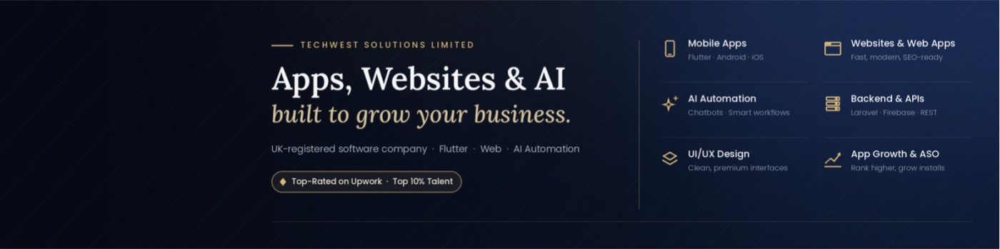
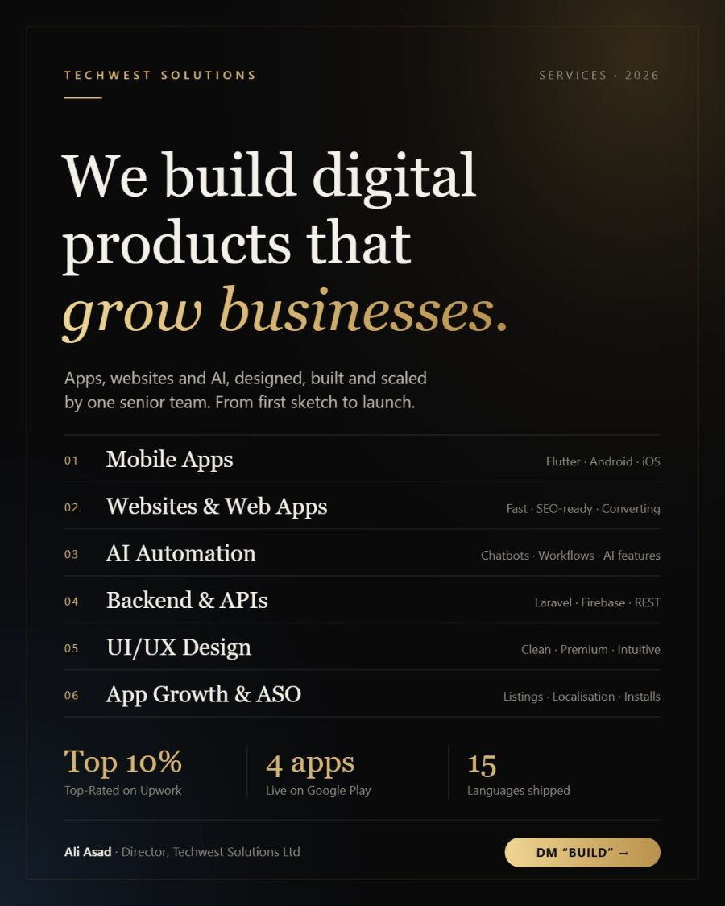
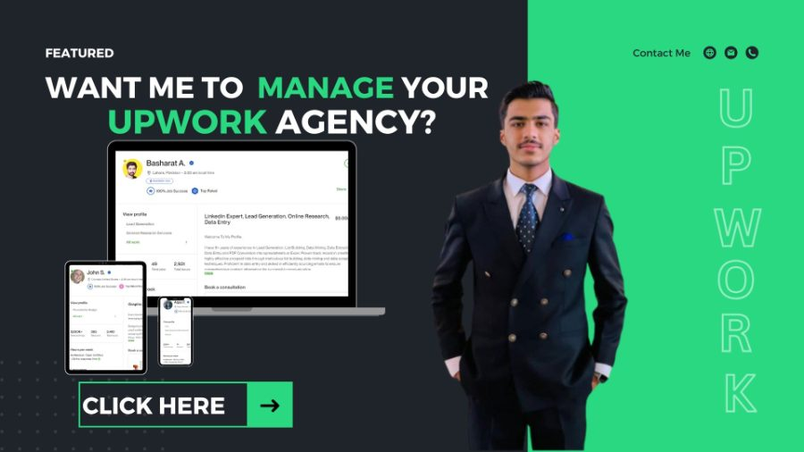
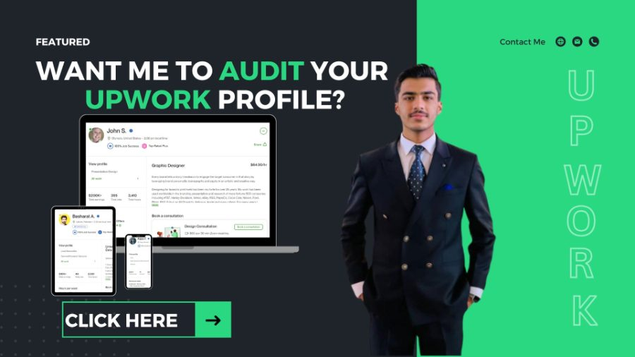

  

<h1 align="center">Hi, I'm Ali Asad 👋</h1>

  <b>Director @ Techwest Solutions Ltd</b> 
  I build Flutter apps, websites & AI automations that grow businesses 
  Top-Rated on Upwork (Top 10%) · Mobile • Web • Backend • ASO

  
  
  

---

## 🚀 About

Most businesses don't need more developers. They need **one team that owns the whole thing**, from idea to launch to growth.

**Techwest Solutions Limited** is a UK-registered software company that builds mobile apps, websites and AI-powered tools for startups and growing businesses.

| | What we do |
|---|---|
| 📱 | **Mobile Apps** — Flutter apps for Android & iOS with a smooth, premium feel |
| 🌐 | **Websites & Web Apps** — fast, SEO-ready, built to turn visitors into clients |
| 🤖 | **AI Automation** — chatbots, smart workflows and AI features inside your product |
| ⚙️ | **Backend & APIs** — Laravel, Firebase and REST, secure and ready to scale |
| 🎨 | **UI/UX Design** — clean interfaces people actually enjoy using |
| 📈 | **App Growth & ASO** — store listings, localisation and more installs |

**Why clients choose us:** ✔ Top-Rated on Upwork (Top 10%) · ✔ UK-registered company · ✔ 4 of our own apps live on Google Play, in up to 15 languages · ✔ Clear scope, weekly demos, clean code

---

## 📱 Our Apps on Google Play

| App | What it does |
|---|---|
| **[ComicToons: CBZ & CBR Reader](https://play.google.com/store/apps/developer?id=TechWestSolutionslimited)** | Offline reader for your own CBZ/CBR/PDF/EPUB files — no sign-up, no ads, WebDAV sync, 11 languages |
| **[MangaNews: Anime Release Dates](https://play.google.com/store/apps/developer?id=TechWestSolutionslimited)** | Anime & manga news in one feed + release calendar with live countdowns, 15 languages |
| **[MANGOVA: Anime Quiz & Trivia](https://play.google.com/store/apps/developer?id=TechWestSolutionslimited)** | Anime quiz and trivia game |
| **[IROVA: Anime Color by Number](https://play.google.com/store/apps/developer?id=TechWestSolutionslimited)** | Anime-style color-by-number app |

---

## 💼 Experience

- **Director — Mobile App, Website & AI Development** · Techwest Solutions Limited · *Apr 2026 – Present*
- **Top Rated Upwork Profile Optimization Expert & Bidder Manager** · Upwork · *Mar 2019 – Present*
- **Software Engineer (.NET)** · CodSoft, Faisalabad · *Sep 2020 – Oct 2024*

🎓 University of Central Punjab (UCP) · 📍 Faisalabad, Punjab, Pakistan

---

## 🧰 Tech Stack

---

## 📝 Posts

<table>
<tr><td width="50%" valign="top"> <b><a href="posts/techwest-one-team.md">One team from idea to launch to growth</a></b> 📅 2026-11-01</td><td width="50%" valign="top"> <b><a href="posts/manganews-launch.md">Launching MangaNews: anime & manga news + release calendar</a></b> 📅 2026-11-01</td></tr>
<tr><td width="50%" valign="top"> <b><a href="posts/comictoons-launch.md">Launching ComicToons: a CBZ & CBR reader for files you own</a></b> 📅 2026-10-31</td><td width="50%" valign="top"> <b><a href="posts/upwork-agency-sales.md">I help agencies grow sales on Upwork</a></b> 📅 2024-10-22</td></tr>
<tr><td width="50%" valign="top"> <b><a href="posts/upwork-5-star-review.md">Struggling to stand out on Upwork?</a></b> 📅 2024-10-21</td><td width="50%" valign="top"> <b><a href="posts/new-to-upwork.md">New to Upwork? Let's turn your profile into a client magnet</a></b> 📅 2024-10-20</td></tr>
<tr><td width="50%" valign="top"> <b><a href="posts/upwork-services.md">My Upwork growth services</a></b> 📅 2024-10-20</td><td width="50%" valign="top"> <b><a href="posts/upwork-services-2.md">My Upwork growth services (part 2)</a></b> 📅 2024-10-19</td></tr>
</table>

➡️ [All posts](posts/README.md) · [Follow on LinkedIn](https://www.linkedin.com/in/ali-asad-980866305/recent-activity/all/)

---

## 📊 GitHub Stats

  
  

---

<b>Got an app, website or AI idea sitting in your notes?</b> 
<a href="https://www.linkedin.com/in/ali-asad-980866305/">Message me on LinkedIn</a> and I'll come back with a clear plan and estimate.

