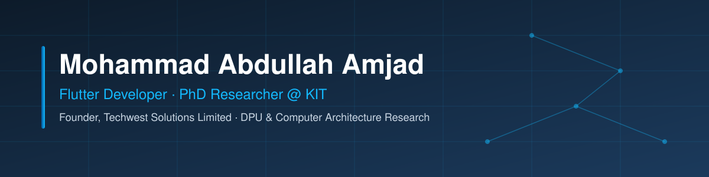

  

## Hi, I'm Aabi 👋

**Flutter Developer · PhD Researcher at KIT · Founder of Techwest Solutions Limited**

I build production mobile apps with Flutter and research high-performance computer architecture at the
Karlsruhe Institute of Technology (KIT), in the CAPP group of Prof. Dr. Wolfgang Karl.

- 📱 Shipping Android apps on Google Play under **Techwest Solutions Limited**
- 🔬 PhD research: measurement studies of **NVIDIA BlueField-2 DPUs** (DPU-to-DPU transfer costs, batching, memory bandwidth, DOCA Comm Channel)
- 🧑‍🏫 Supervising student projects on heterogeneous CPU/GPU placement and FHE profiling
- 🛠️ Leading a small backend team — Laravel, REST APIs, Firebase
- 📍 Karlsruhe, Germany · 💼 Open to freelance Flutter work

---

### 📱 Apps on Google Play

| App | What it does |
|---|---|
| **ComicToons** | Offline CBZ / CBR / PDF / EPUB reader with WebDAV sync |
| **MangaNews** | Anime & manga news with a release calendar, in 15 languages |
| **Mangova** | Anime quiz game |
| **Irova** | Anime color-by-number app |
| **MONTRA Wealth** | Personal finance app |

➡️ [See all apps on Google Play](https://play.google.com/store/apps/developer?id=TechWestSolutionslimited)

---

### 🧰 Tech Stack

**Mobile:**    

**Backend:**    

**Research / Systems:**     

---

### 📊 GitHub Stats

  
  

---

### 🤝 Connect

