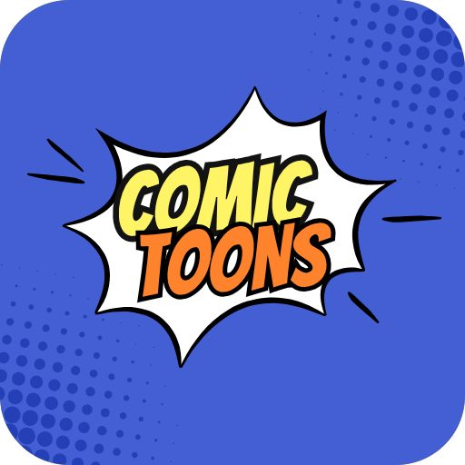

# Launching ComicToons: a CBZ & CBR reader for files you own

📅 Posted on LinkedIn · 2026-10-31 · by **Ali Asad**, Director @ Techwest Solutions Ltd

Most comic reader apps I looked at wanted an account, showed ads, or only worked online. So we built ComicToons.  

It is a CBZ and CBR reader for the files you already own. Add a folder and it sorts your chapters and volumes, remembers where you stopped, and works fully offline. It also opens PDF and EPUB, reads left to right or right to left, and has a dark mode.  

A few things we cared about:  
- No sign-up, no ads, no tracking  
- WebDAV sync if your library sits on a NAS or home server  
- 11 languages, including Urdu, Arabic and Hindi  
- A Discover tab with ratings and trivia quizzes (info only, no manga hosted)  

It is live on Google Play and still improving. If you try it, tell me what is missing.  
https://lnkd.in/dXhwZ5Xx  

If you have an app idea and want a Flutter team to build it, send me a message.  

#ComicReader #CBZ #Manga #Flutter #AndroidApps  

---

[⬅️ All posts](README.md) · [💼 See this on LinkedIn](https://www.linkedin.com/in/ali-asad-980866305/recent-activity/all/)
